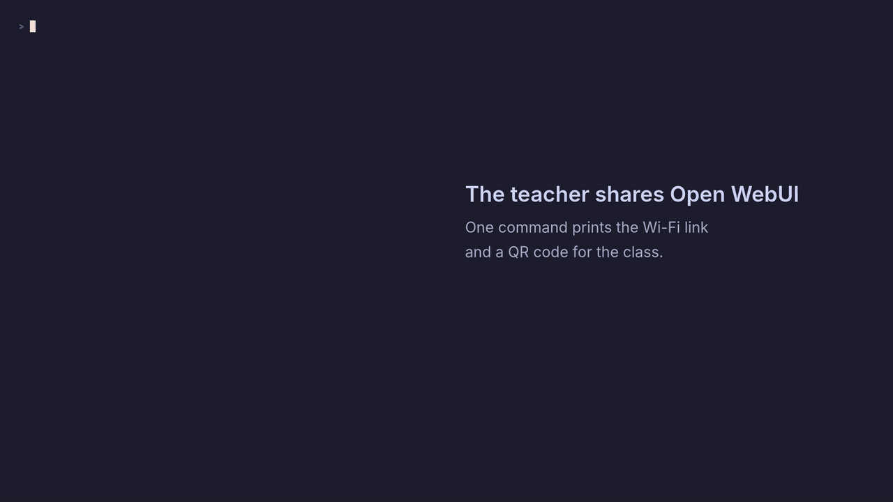

<div align="center">

# pondok-ai

**Jalankan stack AI pribadi Anda sendiri secara lokal dengan satu perintah.**

LLM lokal, antarmuka chat, pencarian vektor, dan API yang kompatibel dengan OpenAI, dirangkai dengan Docker Compose.

[](https://www.npmjs.com/package/pondok-ai)
[](https://github.com/rasidi3112/pondok-ai/actions/workflows/ci.yml)
[](https://nodejs.org)
[](https://docs.docker.com/compose/)
[](./LICENSE)

[English](README.md) · **Bahasa Indonesia** · [한국어](README_ko.md) · [العربية](README_ar.md) · [Español](README_es.md) · [中文](README_zh.md) · [Français](README_fr.md) · [日本語](README_ja.md) · [Deutsch](README_de.md) · [Português](README_pt.md) · [Русский](README_ru.md) · [हिन्दी](README_hi.md) · [Türkçe](README_tr.md) · [Italiano](README_it.md) · [Tiếng Việt](README_vi.md) · [Polski](README_pl.md) · [Bahasa Melayu](README_ms.md)

<sub>Terjemahan dibuat oleh mesin dan mungkin tertinggal dari README bahasa Inggris.</sub>

<br>

<a href="docs/demo/demo.mp4">
  
</a>

<sub>Dari folder kosong hingga balasan dari model lokal. Direkam di Mac Apple M1 dengan Ollama native (GPU Metal), dengan image dan model yang sudah diunduh sebelumnya; waktu tunggu Open WebUI menyala dipercepat dan ditandai di layar. Ruang disk kosong Mac tersebut kurang dari 10 GB, sehingga <code>init</code> dijalankan dengan <code>--force</code>.<br>
<a href="docs/demo/demo.mp4"><b>▶ Tonton video 1080p</b></a></sub>

<br>

[Mulai Cepat](#mulai-cepat) · [Fitur](#fitur) · [Tangkapan Layar](#tangkapan-layar) · [Preset](#preset) · [Berbagi lewat jaringan](#berbagi-lewat-jaringan) · [CLI](#perintah-cli) · [API Gateway](#api-gateway) · [Dokumentasi](#dokumentasi)

</div>

---

## Ikhtisar

`pondok-ai` adalah CLI yang menjalankan lingkungan AI pribadi yang lengkap di komputer Anda sendiri. CLI ini membuat stack Docker Compose yang sesuai dengan perangkat keras Anda, menjalankannya dengan pemeriksaan kesehatan, dan mengelola model untuk Anda.

Prompt, percakapan, dan embedding diproses di komputer Anda. Pengunduhan image container dan bobot model untuk pertama kali memerlukan koneksi internet.

```bash
npx pondok-ai init
npx pondok-ai up
```

<sub>Pondok berarti tempat bernaung sederhana. Paket ini sebelumnya diterbitkan dengan nama `local-ai-stack`.</sub>

## Fitur

| | |
|---|---|
| **Pemrosesan lokal** | Prompt, percakapan, embedding, dan inferensi berjalan di perangkat keras Anda. |
| **Deteksi perangkat keras** | Mendeteksi OS, arsitektur, RAM, disk, dan GPU (Apple Metal, NVIDIA CUDA), lalu merekomendasikan preset dan model yang cocok. |
| **Preset modular** | Pilih mulai dari antarmuka chat ringan (`minimal`), stack RAG (`standard`), hingga pipeline otomatisasi (`full`). |
| **Berbagi lewat jaringan** | `pondok-ai share` menjadikan satu komputer ChatGPT pribadi untuk satu kelas atau kantor: semua orang di WiFi yang sama membuka Open WebUI lewat QR code dan masuk dengan akun masing-masing. |
| **Gateway kompatibel OpenAI** | Arahkan OpenAI SDK atau LangChain ke `http://localhost:8000/v1` tanpa menulis ulang kode. |
| **Manajer model** | Unduh, tampilkan, periksa, dan hapus model, dengan pemeriksaan keamanan RAM dan disk sebelum setiap unduhan. |
| **Diagnostik** | `pondok-ai doctor` memeriksa Docker daemon, port, RAM, disk, dan GPU sebelum Anda menemui masalah. |
| **Pencadangan** | Cadangkan dan pulihkan konfigurasi serta volume data dengan pemeriksaan integritas SHA-256. |

## Mulai Cepat

**Prasyarat:** Node.js 22 atau lebih baru, Docker, dan Docker Compose v2.

**1. Inisialisasi stack**

```bash
# Wizard konfigurasi interaktif dengan deteksi perangkat keras
npx pondok-ai init

# Atau tanpa interaksi dengan preset pilihan
npx pondok-ai init --preset standard --yes
```

**2. Jalankan layanan** (menunggu hingga semua layanan sehat)

```bash
npx pondok-ai up
```

Start pertama bisa memakan waktu beberapa menit karena Open WebUI mengunduh model pendukungnya. Di Mac dengan Ollama native, `up` juga menyalakan Ollama jika belum berjalan. Jika belum ada model yang terpasang, `up` memberi tahu model yang cocok untuk RAM Anda.

**3. Pilih dan instal model**

```bash
# Rekomendasi berdasarkan RAM, VRAM, dan ruang disk kosong Anda
npx pondok-ai model recommend

# Hanya model yang menjawab dengan baik dalam Bahasa Indonesia (Gemma 3, Qwen 2.5, Aya Expanse, BGE-M3)
npx pondok-ai model recommend --lang id

# Instal dengan pemeriksaan awal memori dan disk
npx pondok-ai model install llama3.2:3b
```

Setelah berjalan, buka stack Anda:

| Layanan | URL |
|---|---|
| Open WebUI | [http://localhost:3000](http://localhost:3000) |
| API Gateway | [http://localhost:8000](http://localhost:8000) |
| Ollama | [http://localhost:11434](http://localhost:11434) |
| Qdrant | [http://localhost:6333/dashboard](http://localhost:6333/dashboard) *(jika port dipetakan)* |

<details>
<summary><b>Skrip penginstal</b> (eksperimental, belum dicakup oleh CI)</summary>

**macOS dan Linux**

```bash
curl -fsSL https://raw.githubusercontent.com/rasidi3112/pondok-ai/main/scripts/install.sh | bash
```

**Windows (PowerShell)**

```powershell
iwr -useb https://raw.githubusercontent.com/rasidi3112/pondok-ai/main/scripts/install.ps1 | iex
```

</details>

## Tangkapan Layar

<p align="center">
  
  <br>
  <sub>Open WebUI melakukan chat dengan <code>gemma3:1b</code>, dilayani oleh Ollama native di Mac Apple M1.</sub>
</p>

<table>
  <tr>
    <td width="50%"></td>
    <td width="50%"></td>
  </tr>
  <tr>
    <td align="center"><sub><code>pondok-ai doctor</code> memeriksa Docker, RAM, disk, dan GPU</sub></td>
    <td align="center"><sub><code>pondok-ai model recommend</code> mengurutkan model sesuai kemampuan perangkat keras Anda</sub></td>
  </tr>
</table>

## Preset

| Preset | Layanan yang Disertakan | RAM Minimum | Direkomendasikan Untuk |
|---|---|---|---|
| **`minimal`** | Ollama, Open WebUI | 8 GB | Chat lokal cepat, eksperimen ringan |
| **`standard`** *(default)* | Ollama, Open WebUI, PostgreSQL, Qdrant, API Gateway | 16 GB | Pipeline RAG, pengembangan aplikasi, pengganti OpenAI |
| **`full`** | Standard + mesin otomatisasi n8n | 16+ GB | Agen AI otonom, otomatisasi alur kerja visual |

## Berbagi lewat jaringan

Satu komputer bisa melayani satu kelas, kantor, atau pesantren. Semua orang yang tersambung ke WiFi atau LAN yang sama membuka Open WebUI di browser, masing-masing dengan akun dan riwayat chat sendiri, sementara modelnya berjalan di satu komputer itu.

<a href="docs/demo/classroom.mp4">
  
</a>

<sub>Guru menjalankan <code>pondok-ai share</code>, siswa membuka tautannya di ponsel dan mendaftar, guru menyetujui akunnya, lalu siswa bertanya dalam bahasa Indonesia. Direkam di Mac Apple M1 dengan <code>gemma3:1b</code>; ponselnya adalah browser seukuran ponsel di Wi-Fi yang sama, dan tidak ada bagian yang dipercepat.<br>
<a href="docs/demo/classroom.mp4"><b>▶ Tonton video 1080p</b></a></sub>

1. Nyalakan stack, lalu buka http://localhost:3000 di komputer ini dan buat akun admin.

   ```bash
   npx pondok-ai up
   ```

2. Sebagai admin, buka **Admin Panel > Settings > General**, aktifkan **New Sign Ups**, lalu simpan. Open WebUI mematikan pendaftaran begitu akun admin dibuat. Biarkan **Default User Role** tetap **Pending**.
3. Bagikan Open WebUI ke jaringan lokal:

   ```bash
   npx pondok-ai share
   ```

   Perintah ini menampilkan alamat untuk setiap jaringan yang tersambung, misalnya `http://192.168.1.20:3000`, beserta QR code yang bisa dipindai dengan ponsel. Di terminal berlatar terang, pakai `npx pondok-ai share --light` agar QR code bisa dipindai.
4. Orang-orang mendaftar dari perangkat masing-masing. Setujui satu per satu di **Admin Panel > Users**, lalu mereka bisa langsung chat dengan model yang terpasang di komputer ini.

Aman secara default:

- **Admin dulu.** `share` menolak berjalan sebelum akun admin Open WebUI dibuat, karena akun pertama yang mendaftar menjadi admin.
- **Login selalu aktif.** Akun baru berstatus *pending* sampai admin menyetujuinya di **Admin Panel > Users**.
- **Hanya Open WebUI yang dibagikan.** API gateway, Ollama, Qdrant, dan n8n tetap memakai bind address (`127.0.0.1` secara default), jadi tidak ada layanan tanpa login yang terbuka.

Selama berbagi, pengguna yang sudah disetujui bisa memakai semua model yang terpasang di komputer ini, termasuk yang Anda tandai privat di Workspace. Layar "Account Activation Pending" menampilkan nama dan email admin; matikan **Show Admin Details in Account Pending Overlay** di **Admin Panel > Settings > General** untuk menyembunyikannya.

Lalu lintasnya HTTP biasa, jadi bagikan hanya di jaringan yang dipercaya, bukan WiFi publik. Firewall sistem operasi mungkin meminta izin koneksi masuk saat pertama kali. Hentikan dengan `npx pondok-ai share --stop`.

## Arsitektur

```
┌───────────────────────────────────────────────────────────────┐
│                      Host Machine (CLI)                       │
│                                                               │
│   Port 3000                 Port 8000           Port 5678     │
│       │                         │                   │         │
└───────┼─────────────────────────┼───────────────────┼─────────┘
        ▼                         ▼                   ▼
  ┌───────────┐             ┌───────────┐       ┌───────────┐
  │ Open      │             │ API       │       │ n8n       │
  │ WebUI     │             │ Gateway   │       │ (Full)    │
  └─────┬─────┘             └─────┬─────┘       └─────┬─────┘
        │                         │                   │
        ├─────────────────────────┼───────────────────┤
        ▼                         ▼                   ▼
  ┌───────────┐             ┌───────────┐       ┌───────────┐
  │ Ollama    │             │ Qdrant    │       │ Postgres  │
  │ (LLMs)    │             │ (Vector)  │       │ (State)   │
  └───────────┘             └───────────┘       └───────────┘
```

Lihat [Ikhtisar Arsitektur](./docs/architecture.md) untuk detailnya.

## Perintah CLI

| Perintah | Deskripsi |
|---|---|
| `pondok-ai init` | Menjalankan wizard konfigurasi interaktif dengan deteksi perangkat keras |
| `pondok-ai up` | Memvalidasi konfigurasi Compose, menjalankan container, dan menunggu pemeriksaan kesehatan |
| `pondok-ai down` | Menghentikan dan menghapus container stack |
| `pondok-ai start` | Menjalankan container yang sudah ada dan sedang berhenti |
| `pondok-ai stop` | Menghentikan container yang sedang berjalan |
| `pondok-ai restart` | Memulai ulang container stack |
| `pondok-ai status` | Menampilkan kesehatan container dan URL |
| `pondok-ai logs [service]` | Menampilkan log (`-f` untuk streaming) |
| `pondok-ai doctor` | Mendiagnosis Docker, RAM, GPU/VRAM, port, dan rekomendasi model |
| `pondok-ai update` | Mengunduh ulang image dengan versi yang dipatok, disertai pencadangan otomatis dan pemeriksaan kesehatan |
| `pondok-ai backup` | Mencadangkan konfigurasi dan volume data dengan pemeriksaan integritas SHA-256 (tidak dienkripsi) |
| `pondok-ai restore <path>` | Memulihkan dari cadangan yang diperiksa integritas SHA-256-nya (tidak dienkripsi) |
| `pondok-ai reset` | Mengatur ulang stack (volume dipertahankan kecuali `--delete-data` digunakan) |
| `pondok-ai config` | Memeriksa atau mengedit konfigurasi aktif |
| `pondok-ai share` | Membagikan Open WebUI ke WiFi atau LAN dengan QR code (`--stop` untuk berhenti) |
| `pondok-ai model list` | Menampilkan daftar model yang sudah diunduh |
| `pondok-ai model recommend` | Rekomendasi model sesuai perangkat keras (RAM, VRAM, disk); `--lang id` untuk Bahasa Indonesia |
| `pondok-ai model install <name>` | Mengunduh model baru dengan pemeriksaan awal ketersediaan sumber daya |
| `pondok-ai model remove <name>` | Menghapus model yang terpasang |
| `pondok-ai model status` | Memeriksa kebutuhan sumber daya model |

Image dipatok ke versi yang eksplisit. `pondok-ai update` memperbarui versi yang dikonfigurasi; perintah ini tidak memilih rilis yang lebih baru. Setelah menginstal CLI yang lebih baru, jalankan `pondok-ai update --upgrade-images` untuk memigrasikan hanya tag image default lama milik CLI. Nilai image kustom tetap dipertahankan.

## API Gateway

API Gateway menyediakan endpoint REST OpenAI yang bisa langsung menggantikan aslinya. Atur `PONDOK_AI_API_KEY` ke `API_SECRET_KEY` yang dihasilkan sebelum memanggil endpoint `/v1/*`.

Secara default, gateway membatasi permintaan `/v1/*` yang terautentikasi sebanyak 120 permintaan per menit untuk setiap klien (IP sumber dan API key). Atur `RATE_LIMIT_MAX_REQUESTS` dan `RATE_LIMIT_WINDOW_MS` di `.env` jika klien lokal Anda memerlukan batas yang berbeda.

```bash
curl http://localhost:8000/v1/chat/completions \
  -H "Content-Type: application/json" \
  -H "Authorization: Bearer $PONDOK_AI_API_KEY" \
  -d '{
    "model": "llama3.2:3b",
    "messages": [
      { "role": "user", "content": "Hello from pondok-ai!" }
    ]
  }'
```

<details>
<summary><b>Menggunakan OpenAI Node.js SDK resmi</b></summary>

```typescript
import OpenAI from 'openai';

const apiKey = process.env.PONDOK_AI_API_KEY;
if (!apiKey) {
  throw new Error('Set PONDOK_AI_API_KEY to your generated API_SECRET_KEY.');
}

const openai = new OpenAI({
  baseURL: 'http://localhost:8000/v1',
  apiKey,
});

const completion = await openai.chat.completions.create({
  model: 'llama3.2:3b',
  messages: [{ role: 'user', content: 'Explain quantum computing in one sentence.' }],
});

console.log(completion.choices[0].message.content);
```

</details>

Lihat [Referensi API Gateway](./docs/api-reference.md) untuk semua endpoint.

## Contoh

- [`examples/openai-compat/`](./examples/openai-compat): Skrip integrasi OpenAI SDK yang bisa langsung dipakai.
- [`examples/rag-example/`](./examples/rag-example): Pipeline RAG lengkap menggunakan database vektor Qdrant dan embedding Ollama.

## Teruji di CI

Setiap pull request menjalankan pengujian end-to-end di GitHub Actions (amd64 dan arm64): init, up, mengunduh model yang sangat kecil (smollm:135m, sekitar 90 MB), menampilkannya lewat /v1/models, permintaan /v1/chat/completions tanpa streaming, pembatasan laju (401 dan 429), dan pemeriksaan bahwa halaman awal Open WebUI merespons. Belum dicakup: respons streaming, embedding, akselerasi GPU, serta host macOS/Windows.

Juga diuji secara manual di Mac Apple M1 dengan Docker Desktop dan Ollama dari Homebrew (0.5.2): `init` dengan preset `minimal` dan Ollama native, `up`, masuk ke Open WebUI, chat dengan `gemma3:1b`, serta membuka `pondok-ai share` dari ponsel di Wi-Fi yang sama.

## Keterbatasan yang diketahui

- Belum diuji pada host Windows. macOS sudah diuji secara manual di Apple Silicon (lihat di atas), tetapi belum di CI.
- Di Apple Silicon, container Docker tidak dapat menggunakan GPU. Jalankan `pondok-ai init --native-ollama` untuk memakai Ollama yang terinstal secara native dengan Metal; lihat [panduan GPU](./docs/gpu-setup.md).
- Akselerasi GPU, respons streaming, dan embedding belum dicakup oleh CI.
- Image-nya berukuran besar (beberapa GB). Siapkan ruang disk kosong yang cukup; workspace cloud 32 GB dengan 19 GB kosong pernah kehabisan ruang saat mengekstrak image Ollama.

## Dokumentasi

- [Ikhtisar Arsitektur](./docs/architecture.md)
- [Referensi API Gateway](./docs/api-reference.md)
- [Panduan Konfigurasi](./docs/configuration.md)
- [Pengaturan Akselerasi GPU (Metal / CUDA)](./docs/gpu-setup.md)
- [Pemecahan Masalah dan Diagnostik](./docs/troubleshooting.md)
- [Merekam demo README](./docs/demo/RECORDING.md)

## Kontribusi

Kontribusi sangat dipersilakan! Baca [CONTRIBUTING.md](./CONTRIBUTING.md) untuk memulai.

## Lisensi

[MIT](./LICENSE) © 2026 kontributor pondok-ai
