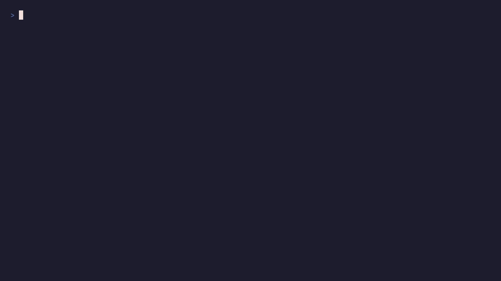
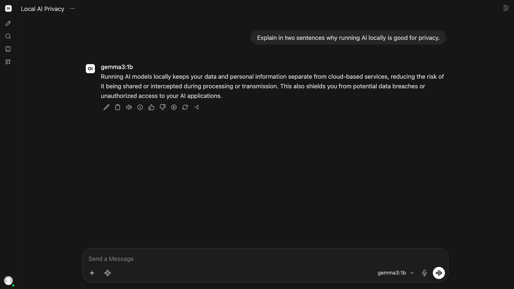
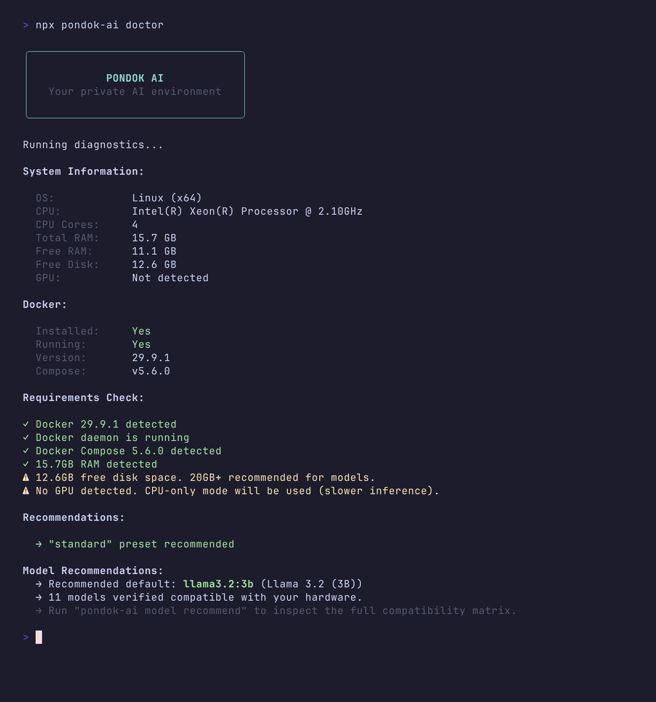
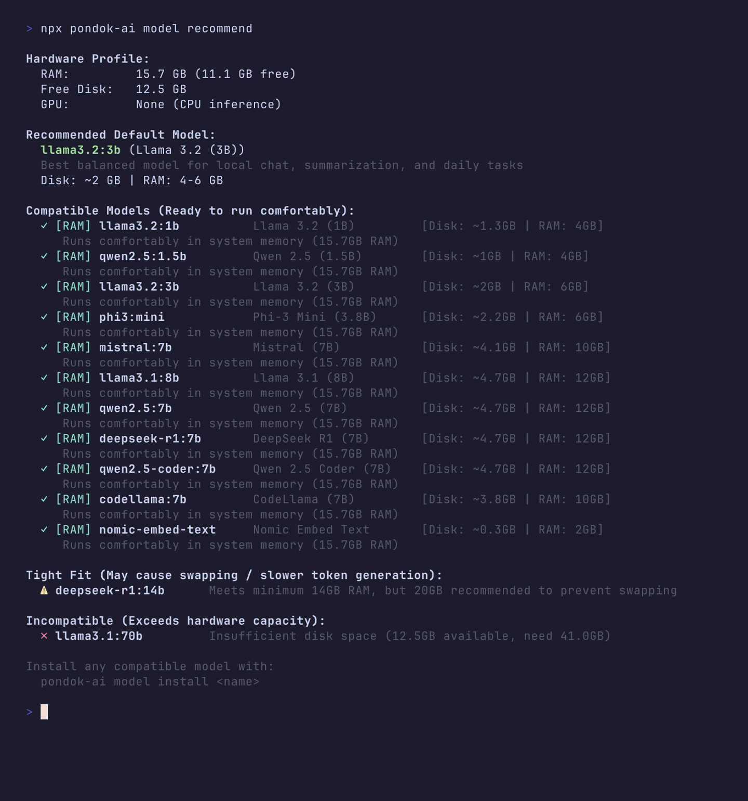

<div align="center">

# pondok-ai

**Kendi özel yapay zekâ yığınınızı tek komutla yerelde çalıştırın.**

Yerel LLM'ler, bir sohbet arayüzü, vektör arama ve OpenAI uyumlu bir API, Docker Compose ile bir araya getirildi.

[](https://www.npmjs.com/package/pondok-ai)
[](https://github.com/rasidi3112/pondok-ai/actions/workflows/ci.yml)
[](https://nodejs.org)
[](https://docs.docker.com/compose/)
[](./LICENSE)

[English](README.md) · [Bahasa Indonesia](README_id.md) · [한국어](README_ko.md) · [العربية](README_ar.md) · [Español](README_es.md) · [中文](README_zh.md) · [Français](README_fr.md) · [日本語](README_ja.md) · [Deutsch](README_de.md) · [Português](README_pt.md) · [Русский](README_ru.md) · [हिन्दी](README_hi.md) · **Türkçe** · [Italiano](README_it.md) · [Tiếng Việt](README_vi.md) · [Polski](README_pl.md) · [Bahasa Melayu](README_ms.md)

<sub>Çeviriler makine tarafından oluşturulur ve İngilizce README'nin gerisinde kalabilir.</sub>

<br>

<a href="docs/demo/demo.mp4">
  
</a>

<sub>Boş bir klasörden yerel bir modelin yanıtına. Yalnızca CPU'lu bir makinede, imajlar ve model önceden indirilmiş olarak kaydedildi; bekleme süreleri hızlandırıldı ve ekranda belirtildi.<br>
<a href="docs/demo/demo.mp4"><b>▶ 1080p videoyu izleyin</b></a></sub>

<br>

[Hızlı Başlangıç](#hızlı-başlangıç) · [Özellikler](#özellikler) · [Ekran Görüntüleri](#ekran-görüntüleri) · [Ön Ayarlar](#ön-ayarlar) · [CLI](#cli-komutları) · [API Ağ Geçidi](#api-ağ-geçidi) · [Belgeler](#belgeler)

</div>

---

## Genel Bakış

`pondok-ai`, kendi makinenizde eksiksiz ve özel bir yapay zekâ ortamı ayağa kaldıran bir CLI'dır. Donanımınıza uygun bir Docker Compose yığını oluşturur, sağlık kontrolleriyle başlatır ve modelleri sizin için yönetir.

İstemler, sohbetler ve embedding'ler makinenizde işlenir. Konteyner imajlarının ve model ağırlıklarının ilk kez indirilmesi için internet bağlantısı gerekir.

```bash
npx pondok-ai init
npx pondok-ai up
```

<sub>Pondok, Endonezce'de küçük bir kulübe ya da barınak anlamına gelir. Paket daha önce `local-ai-stack` adıyla yayımlanıyordu.</sub>

## Özellikler

| | |
|---|---|
| **Yerel işleme** | İstemler, sohbetler, embedding'ler ve çıkarım donanımınızda çalışır. |
| **Donanım algılama** | İşletim sistemini, mimariyi, RAM'i, diski ve GPU'yu (Apple Metal, NVIDIA CUDA) algılar; uygun bir ön ayar ve modeller önerir. |
| **Modüler ön ayarlar** | Hafif bir sohbet arayüzünden (`minimal`) bir RAG yığınına (`standard`) ya da bir otomasyon hattına (`full`) ölçeklendirin. |
| **OpenAI uyumlu ağ geçidi** | OpenAI SDK'larını veya LangChain'i kod yeniden yazmadan `http://localhost:8000/v1` adresine yönlendirin. |
| **Model yöneticisi** | Modelleri indirin, listeleyin, inceleyin ve kaldırın; her indirmeden önce RAM ve disk güvenlik kontrolleri yapılır. |
| **Tanılama** | `pondok-ai doctor`, sorunlarla karşılaşmadan önce Docker arka plan hizmetini, portları, RAM'i, diski ve GPU'yu denetler. |
| **Yedekler** | Yapılandırmaları ve veri birimlerini SHA-256 bütünlük kontrolleriyle yedekleyin ve geri yükleyin. |

## Hızlı Başlangıç

**Ön koşullar:** Node.js 22 veya üzeri, Docker ve Docker Compose v2.

**1. Yığını başlatın**

```bash
# Donanım algılamalı etkileşimli kurulum sihirbazı
npx pondok-ai init

# Ya da seçilen bir ön ayarla etkileşimsiz
npx pondok-ai init --preset standard --yes
```

**2. Hizmetleri başlatın** (tüm hizmetler sağlıklı olana kadar bekler)

```bash
npx pondok-ai up
```

İlk başlatma, Open WebUI yardımcı modellerini indirirken birkaç dakika sürebilir. Yerel Ollama kullanan bir Mac'te `up`, çalışmıyorsa Ollama'yı da başlatır. Henüz kurulu bir model yoksa `up`, RAM'inize uygun olanı söyler.

**3. Bir model seçip kurun**

```bash
# RAM, VRAM ve boş disk alanınıza göre öneriler
npx pondok-ai model recommend

# Önceden bellek ve disk kontrolüyle kurulum
npx pondok-ai model install llama3.2:3b
```

Çalışmaya başladığında yığınınızı açın:

| Hizmet | URL |
|---|---|
| Open WebUI | [http://localhost:3000](http://localhost:3000) |
| API Ağ Geçidi | [http://localhost:8000](http://localhost:8000) |
| Ollama | [http://localhost:11434](http://localhost:11434) |
| Qdrant | [http://localhost:6333/dashboard](http://localhost:6333/dashboard) *(port eşlendiğinde)* |

<details>
<summary><b>Kurulum betikleri</b> (deneysel, CI kapsamında değil)</summary>

**macOS ve Linux**

```bash
curl -fsSL https://raw.githubusercontent.com/rasidi3112/pondok-ai/main/scripts/install.sh | bash
```

**Windows (PowerShell)**

```powershell
iwr -useb https://raw.githubusercontent.com/rasidi3112/pondok-ai/main/scripts/install.ps1 | iex
```

</details>

## Ekran Görüntüleri

<p align="center">
  
  <br>
  <sub>Yerel Ollama konteynerinin sunduğu <code>llama3.2:3b</code> ile sohbet eden Open WebUI.</sub>
</p>

<table>
  <tr>
    <td width="50%"></td>
    <td width="50%"></td>
  </tr>
  <tr>
    <td align="center"><sub><code>pondok-ai doctor</code> Docker'ı, RAM'i, diski ve GPU'yu denetler</sub></td>
    <td align="center"><sub><code>pondok-ai model recommend</code> modelleri donanımınızın çalıştırabileceklerine göre sıralar</sub></td>
  </tr>
</table>

## Ön Ayarlar

| Ön Ayar | Dahil Olan Hizmetler | Min. RAM | Önerilen Kullanım |
|---|---|---|---|
| **`minimal`** | Ollama, Open WebUI | 8 GB | Hızlı yerel sohbet, hafif denemeler |
| **`standard`** *(varsayılan)* | Ollama, Open WebUI, PostgreSQL, Qdrant, API Gateway | 16 GB | RAG hatları, uygulama geliştirme, OpenAI alternatifi |
| **`full`** | Standard + n8n otomasyon motoru | 16+ GB | Otonom yapay zekâ ajanları, görsel iş akışı otomasyonu |

## Mimari

```
┌───────────────────────────────────────────────────────────────┐
│                      Host Machine (CLI)                       │
│                                                               │
│   Port 3000                 Port 8000           Port 5678     │
│       │                         │                   │         │
└───────┼─────────────────────────┼───────────────────┼─────────┘
        ▼                         ▼                   ▼
  ┌───────────┐             ┌───────────┐       ┌───────────┐
  │ Open      │             │ API       │       │ n8n       │
  │ WebUI     │             │ Gateway   │       │ (Full)    │
  └─────┬─────┘             └─────┬─────┘       └─────┬─────┘
        │                         │                   │
        ├─────────────────────────┼───────────────────┤
        ▼                         ▼                   ▼
  ┌───────────┐             ┌───────────┐       ┌───────────┐
  │ Ollama    │             │ Qdrant    │       │ Postgres  │
  │ (LLMs)    │             │ (Vector)  │       │ (State)   │
  └───────────┘             └───────────┘       └───────────┘
```

Ayrıntılar için [Mimariye Genel Bakış](./docs/architecture.md) belgesine bakın.

## CLI Komutları

| Komut | Açıklama |
|---|---|
| `pondok-ai init` | Donanım algılamalı etkileşimli yapılandırma sihirbazını çalıştırır |
| `pondok-ai up` | Compose yapılandırmasını doğrular, konteynerleri başlatır ve sağlık kontrollerini bekler |
| `pondok-ai down` | Yığın konteynerlerini durdurur ve kaldırır |
| `pondok-ai start` | Durdurulmuş mevcut konteynerleri başlatır |
| `pondok-ai stop` | Çalışan konteynerleri durdurur |
| `pondok-ai restart` | Yığın konteynerlerini yeniden başlatır |
| `pondok-ai status` | Konteyner sağlığını ve URL'leri gösterir |
| `pondok-ai logs [service]` | Günlükleri görüntüler (akış için `-f`) |
| `pondok-ai doctor` | Docker, RAM, GPU/VRAM ve portları tanılar, model önerileri sunar |
| `pondok-ai update` | Yapılandırılmış sabit sürümlü imajları otomatik yedekleme ve sağlık kontrolleriyle yeniden çeker |
| `pondok-ai backup` | Yapılandırmaları ve veri birimlerini SHA-256 bütünlük kontrolleriyle yedekler (şifrelenmez) |
| `pondok-ai restore <path>` | SHA-256 ile bütünlüğü doğrulanmış bir yedekten geri yükler (şifrelenmez) |
| `pondok-ai reset` | Yığını sıfırlar (`--delete-data` belirtilmedikçe birimler korunur) |
| `pondok-ai config` | Etkin yapılandırmayı inceler veya düzenler |
| `pondok-ai model list` | İndirilen modelleri listeler |
| `pondok-ai model recommend` | Donanıma göre model önerileri (RAM, VRAM, disk) |
| `pondok-ai model install <name>` | Önceden kaynak güvenlik kontrolleriyle yeni bir model çeker |
| `pondok-ai model remove <name>` | Kurulu bir modeli siler |
| `pondok-ai model status` | Modellerin kaynak kullanımını inceler |

İmajlar açıkça belirtilmiş sürümlere sabitlenmiştir. `pondok-ai update` yapılandırılmış sürümleri yeniler; daha yeni sürümleri seçmez. Daha yeni bir CLI kurduktan sonra, yalnızca CLI'nın eski varsayılan imaj etiketlerini taşımak için `pondok-ai update --upgrade-images` komutunu çalıştırın. Özel imaj değerleri korunur.

## API Ağ Geçidi

API Ağ Geçidi, doğrudan yerine geçebilen OpenAI REST uç noktaları sağlar. Bir `/v1/*` uç noktasını çağırmadan önce `PONDOK_AI_API_KEY` değişkenini oluşturulan `API_SECRET_KEY` değerine ayarlayın.

Ağ geçidi, kimliği doğrulanmış `/v1/*` isteklerini varsayılan olarak istemci başına (kaynak IP ve API anahtarı) dakikada 120 istekle sınırlar. Yerel istemciniz farklı sınırlara ihtiyaç duyuyorsa `.env` içinde `RATE_LIMIT_MAX_REQUESTS` ve `RATE_LIMIT_WINDOW_MS` değerlerini yapılandırın.

```bash
curl http://localhost:8000/v1/chat/completions \
  -H "Content-Type: application/json" \
  -H "Authorization: Bearer $PONDOK_AI_API_KEY" \
  -d '{
    "model": "llama3.2:3b",
    "messages": [
      { "role": "user", "content": "Hello from pondok-ai!" }
    ]
  }'
```

<details>
<summary><b>Resmî OpenAI Node.js SDK'sı ile kullanım</b></summary>

```typescript
import OpenAI from 'openai';

const apiKey = process.env.PONDOK_AI_API_KEY;
if (!apiKey) {
  throw new Error('Set PONDOK_AI_API_KEY to your generated API_SECRET_KEY.');
}

const openai = new OpenAI({
  baseURL: 'http://localhost:8000/v1',
  apiKey,
});

const completion = await openai.chat.completions.create({
  model: 'llama3.2:3b',
  messages: [{ role: 'user', content: 'Explain quantum computing in one sentence.' }],
});

console.log(completion.choices[0].message.content);
```

</details>

Tüm uç noktalar için [API Ağ Geçidi Başvurusu](./docs/api-reference.md) belgesine bakın.

## Örnekler

- [`examples/openai-compat/`](./examples/openai-compat): Doğrudan yerine geçen OpenAI SDK entegrasyon betiği.
- [`examples/rag-example/`](./examples/rag-example): Qdrant vektör veritabanı ve Ollama embedding'leri kullanan uçtan uca RAG hattı.

## CI'da Test Edildi

Her pull request, GitHub Actions üzerinde (amd64 ve arm64) uçtan uca bir test çalıştırır: init, up, çok küçük bir modelin çekilmesi (smollm:135m, yaklaşık 90 MB), /v1/models ile listelenmesi, akışsız bir /v1/chat/completions isteği, hız sınırlama (401 ve 429) ve Open WebUI başlangıç sayfasının yanıt verdiğinin kontrolü. Henüz kapsanmayanlar: akışlı yanıtlar, embedding'ler, GPU hızlandırma ve macOS/Windows ana makineleri.

Ayrıca Docker Desktop ve Homebrew'dan kurulan Ollama ile bir Apple M1 Mac'te elle test edildi (0.5.2): `minimal` ön ayarı ve yerel Ollama ile `init`, `up`, Open WebUI'ye giriş, `gemma3:1b` ile sohbet ve aynı Wi-Fi'deki bir telefondan açılan `pondok-ai share`.

## Bilinen sınırlamalar

- Henüz Windows ana makinelerinde test edilmedi. macOS, Apple Silicon üzerinde elle test edildi (yukarıya bakın), ancak CI'da değil.
- Apple Silicon'da Docker konteynerleri GPU'yu kullanamaz. Bunun yerine Metal ile yerel olarak kurulmuş bir Ollama kullanmak için `pondok-ai init --native-ollama` komutunu çalıştırın; [GPU kılavuzuna](./docs/gpu-setup.md) bakın.
- GPU hızlandırma, akışlı yanıtlar ve embedding'ler henüz CI kapsamında değil.
- İmajlar büyüktür (birkaç GB). Bol miktarda boş disk alanı ayırın; 19 GB boş alanı olan 32 GB'lık bir bulut çalışma alanı, Ollama imajını açarken yer kalmadığı için başarısız oldu.

## Belgeler

- [Mimariye Genel Bakış](./docs/architecture.md)
- [API Ağ Geçidi Başvurusu](./docs/api-reference.md)
- [Yapılandırma Kılavuzu](./docs/configuration.md)
- [GPU Hızlandırma Kurulumu (Metal / CUDA)](./docs/gpu-setup.md)
- [Sorun Giderme ve Tanılama](./docs/troubleshooting.md)
- [README demosunu kaydetme](./docs/demo/RECORDING.md)

## Katkıda Bulunma

Katkılarınızı bekliyoruz! Başlamak için [CONTRIBUTING.md](./CONTRIBUTING.md) dosyasına göz atın.

## Lisans

[MIT](./LICENSE) © 2026 pondok-ai katkıda bulunanları
